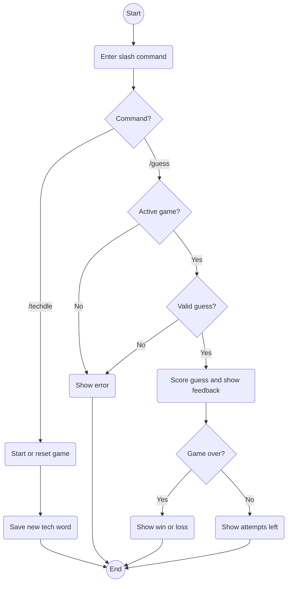

## Abhi - Activity Diagram

This activity diagram shows how TechdleBot handles its two slash commands. The `/techdle` command starts a new game or resets an existing one with a new word. The `/guess` command checks whether the player has an active game and submitted a valid five-letter guess. The bot then provides feedback and either displays the remaining attempts or ends the game with a win or loss.

