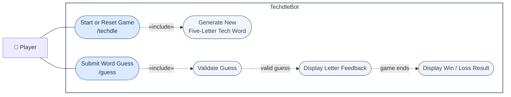

# TechdleBot Use Case Diagram

The command definitions are in `src/commands/techdle.js`; `src/events/interactionCreate.js` handles the commands; and `src/game/` contains the game rules and storage.
