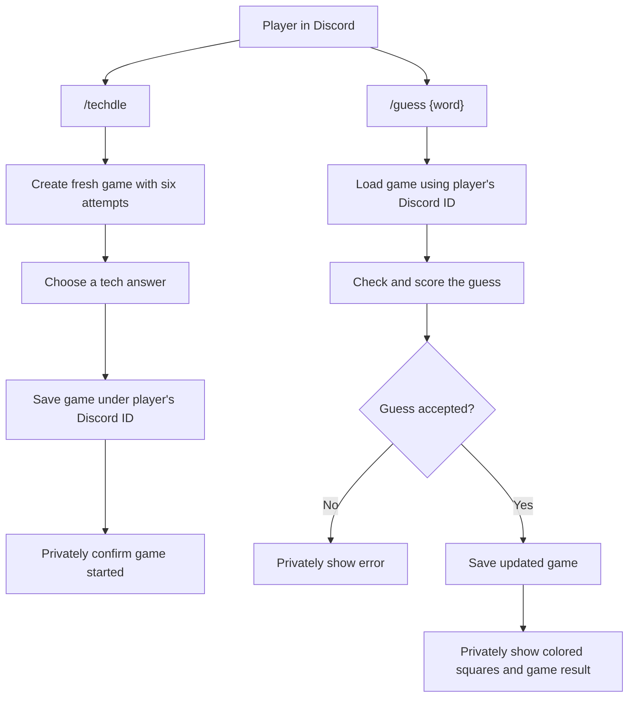
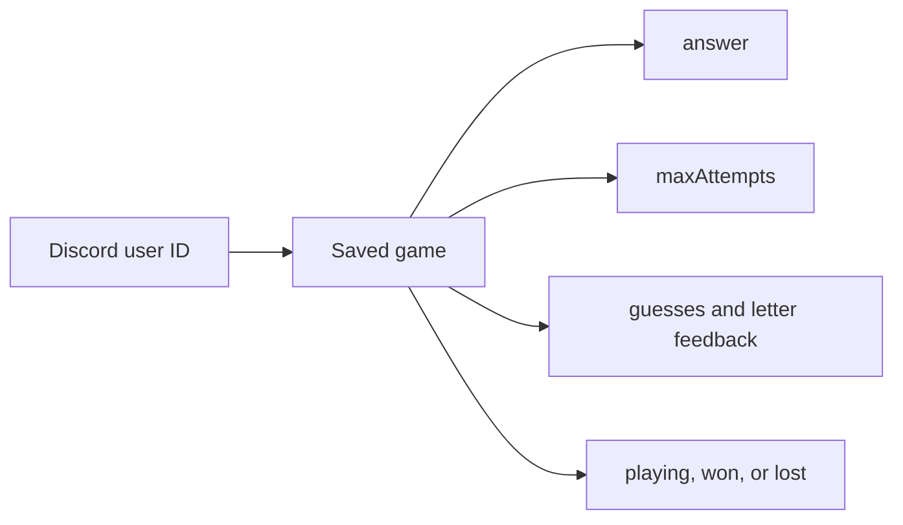

## Slash-Command Game

A player starts a fresh Techdle game with `/techdle`. The bot saves that game using the player’s Discord ID. When the player submits `/guess {word}`, the bot loads that player’s game, checks and scores the guess, saves accepted guesses, and privately replies with the colored feedback and game result.

### Command flow

### Saved game data

Each Discord user ID maps to that player's current game. Starting `/techdle` replaces that player's game and clears their guess history.

The slash-command handler is in `src/events/interactionCreate.js`. `src/game/start.js` creates fresh games, `src/game/game.js` processes guesses and determines game status, `src/game/feedback.js` scores and formats the colored squares, and `src/game/store.js` saves player games in `data/techdle-games.json`.
