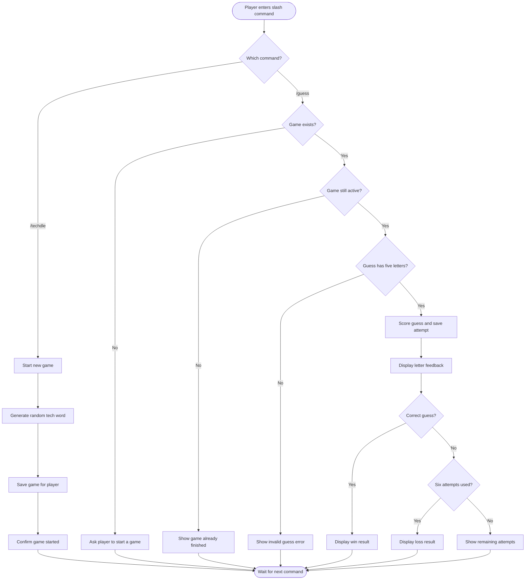

# Abhi - Use Case Diagram

The use case diagram shows how a Discord player interacts with TechdleBot through its two slash commands. Players can start or reset a game with `/techdle` and submit guesses with `/guess`. A game must exist before a player can submit a guess.

```mermaid
usecase-beta
direction TB

actor Player

systemBoundary "TechdleBot"
  StartGame("Start or reset game with /techdle")
  SubmitGuess("Submit a five-letter guess with /guess")
end

Player --> StartGame
Player --> SubmitGuess
```

## Techdle Gameplay Activity Diagram

This activity diagram shows how TechdleBot processes the two slash commands. The bot stores one game per Discord user, checks guesses, and returns feedback until the player wins or uses all six attempts.



## Related Code

- `src/commands/techdle.js` defines the `/techdle` and `/guess` slash commands.
- `src/events/interactionCreate.js` processes player commands and sends Discord responses.
- `src/game/start.js` creates new games and replaces existing games.
- `src/game/game.js` tracks guesses, attempts, and win/loss status.
- `src/game/validate.js` validates five-letter guesses.
- `src/game/feedback.js` generates letter feedback.
- `src/game/store.js` saves game state in a JSON file.
- `src/game/words.js` provides the possible tech-word answers.
