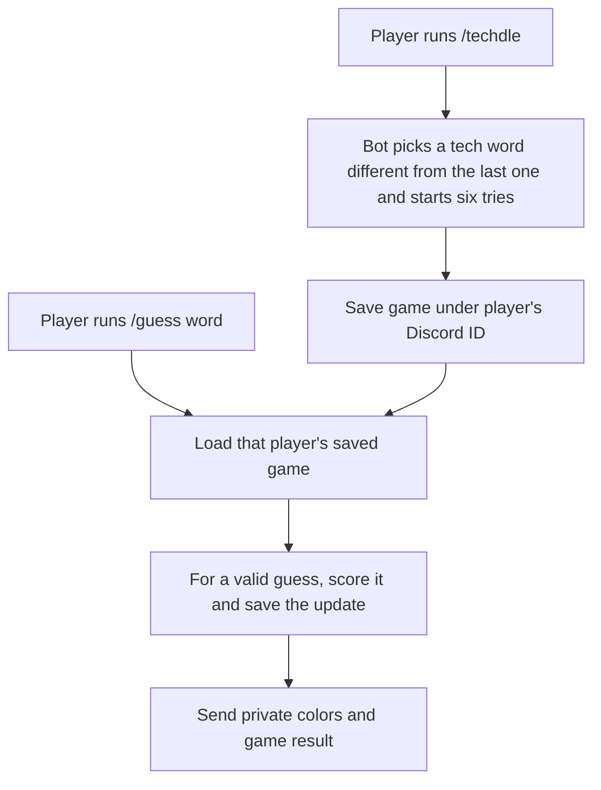

# My Techdle feature

This diagram shows how my `/techdle` and `/guess` commands use the game code and saved game file.

Each player has one current game. Starting `/techdle` again replaces that player's game. Guesses must be five letters; any five-letter guess is scored, without checking a word list. Invalid guesses use no attempt.

**Code:** `src/events/interactionCreate.js` handles commands and replies; `src/game/` contains the rules and feedback; `src/game/store.js` saves games; and `src/game/words.js` provides tech answers.
