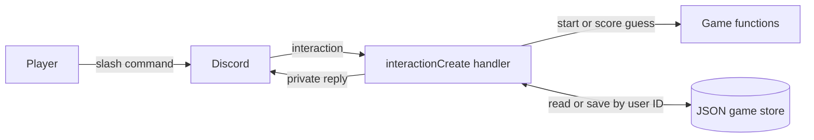
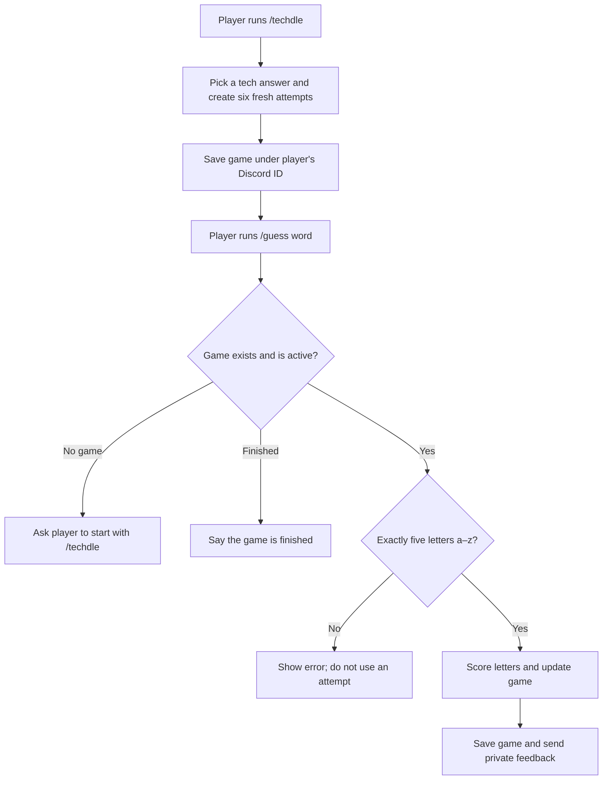

# Techdle slash-command feature

This section explains my `/techdle` and `/guess` feature: how Discord commands reach the game code, how a player's game is saved, and where teammates can extend it.

## System architecture: data flow

The interaction handler connects Discord to the game rules and saved game data. Replies are private to the player.

## Code architecture

| Code | What it does |
| --- | --- |
| `src/commands/techdle.js` | Defines `/techdle` and `/guess word` for Discord. |
| `src/events/interactionCreate.js` | Routes commands, finds the player's game, saves accepted guesses, and sends replies. |
| `src/game/start.js` | Picks a tech answer and starts a fresh six-attempt game, replacing only that player's old game. |
| `src/game/game.js` | Validates guesses, updates the game state, and checks win/loss. |
| `src/game/feedback.js` | Calculates green, yellow, and gray letter feedback. |
| `src/game/store.js` | Reads and writes games in a JSON file keyed by Discord user ID. |
| `src/game/words.js` | Provides the tech words used as possible answers. |

## Activity: playing a game

The current validator accepts any five letters from `a` to `z`; it does not check a dictionary. Accepted guesses use one of the six attempts. Starting `/techdle` again replaces that player's current game. Other players' games stay separate.

## Extending this feature

To add a slash command, define it in `src/commands/techdle.js` and route it in `src/events/interactionCreate.js`. Put game rules in `src/game/`, and reuse the saved game store with the Discord user ID so each player's state stays separate.

The JSON store defaults to `data/techdle-games.json` and can be moved with `TECHDLE_GAME_STORE`. It is designed for one running bot process; if the team later runs multiple bot instances, game data should move to shared storage.
