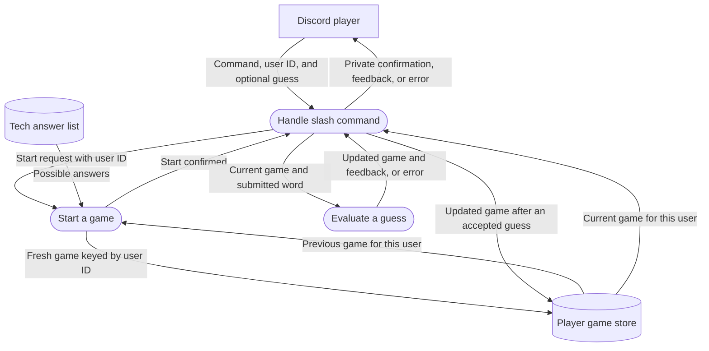

# Techdle Bot Architecture

## Starting and saving a player's game

Techdle keeps one slash-command game per Discord user ID. When a player runs `/techdle`, the bot chooses a random five-letter tech answer, excluding that player's previous answer. The new game starts with six attempts, an empty guess history, and a status of `playing`.

Starting a game replaces only that player's entry. For example, if Abhi starts again while Mario is halfway through a game, Abhi gets a new word and Mario keeps his guesses. The bot uses the same Discord user ID to find the right game when either player runs `/guess`.

### Data flow diagram

The arrows show what information moves between Discord, the game code, and storage.

### How the code fits together

The [Discord handler](src/events/interactionCreate.js) reads the user ID from the interaction. For `/techdle`, it calls [startGame](src/game/start.js), which saves the new game before the bot confirms it. For `/guess`, the handler loads the game for that same ID and passes it and the submitted word to [submitGuess](src/game/game.js). It saves an accepted guess before replying with the colored squares. A rejected guess uses no attempt.

The [game store](src/game/store.js) loads saved games the first time the bot needs them. Its default file is `data/techdle-games.json`. Each update writes a temporary file and renames it over the saved file. Players can resume after a restart as long as that file is retained. The store is designed for one running bot process because each process holds its own copy of the games in memory.
