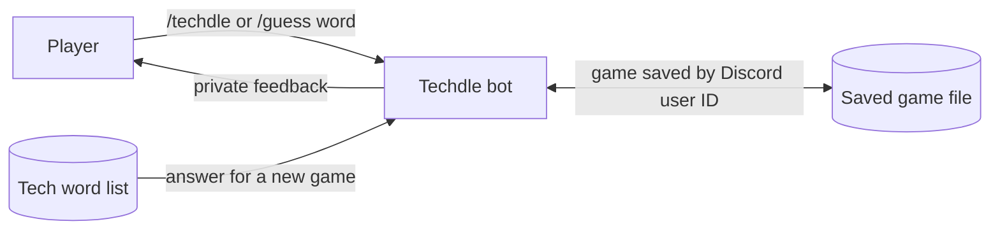

# Techdle slash commands

This section explains my `/techdle` and `/guess` feature: how the player, bot, word list, and saved game file work together.

## Data flow diagram

`/techdle` selects a tech answer different from that user's last answer, starts a new six-attempt game, and saves it. `/guess` loads that user's game, scores the guess, and saves accepted guesses. Inputs are trimmed and lowercased; any five letters are scored without a dictionary check. Replies are private, and each Discord user ID has a separate game.

## Main code files

- `src/events/interactionCreate.js` handles the slash commands and replies privately.
- `src/game/` contains the game rules and letter feedback.
- `src/game/store.js` saves games in a JSON file.
- `src/game/words.js` supplies the possible tech answers.

To add to the slash-command game, route the command in `interactionCreate.js` and put its game rules in `src/game/`.
