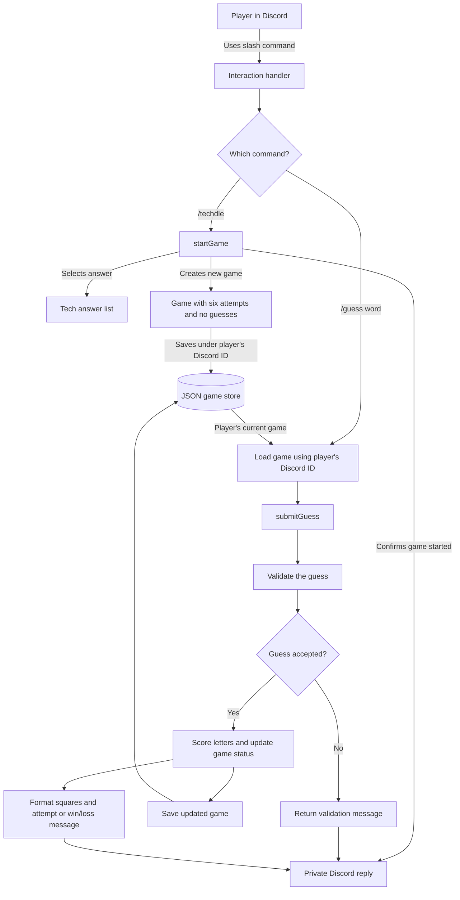
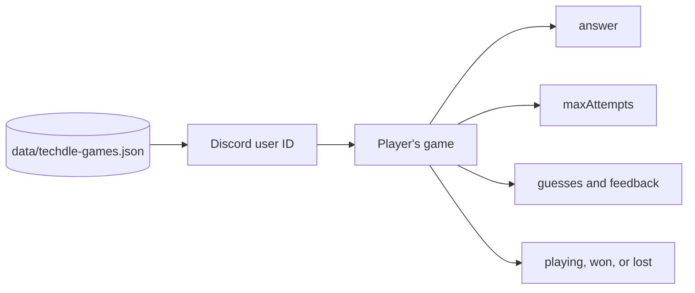

## Slash-Command Game Flow and Saved Player State

The slash-command game lets a Discord player start a Techdle game with `/techdle` and submit guesses with `/guess`. The bot uses the player’s Discord user ID to find that player’s saved game. Starting `/techdle` replaces that player’s current game with a new answer, an empty guess history, and six attempts.

### Game flow

Discord sends slash-command interactions to the interaction handler. The handler routes `/techdle` to the game-start logic and `/guess` to the guess-submission logic.



A rejected guess returns an error and does not change the saved game. An accepted guess is scored, added to the guess history, and saved before the bot replies. The reply shows colored squares and the remaining attempts, or a win/loss result when the game ends.

### Saved game data

The store keeps a separate game object for each Discord user ID. A new `/techdle` replaces only the requesting player’s game. Other players’ saved games remain in the file.



A saved entry has this shape:

```json
{
  "1555271532245295277": {
    "answer": "cloud",
    "maxAttempts": 6,
    "guesses": [
      {
        "guess": "crane",
        "feedback": ["absent", "absent", "present", "absent", "absent"]
      }
    ],
    "status": "playing"
  }
}
```

The JSON file lets the bot restore games after a restart, provided the file remains available. The current store loads the file into the running bot process and writes each update through a temporary file before replacing the saved file. It is designed for one running bot process. Multiple bot processes would each have their own in-memory copy of the games.

### Code responsibilities

- `src/events/interactionCreate.js` receives slash-command interactions, identifies the player, calls the game functions, saves accepted changes, and sends private replies.
- `src/game/start.js` selects a tech answer and creates a fresh game for that player.
- `src/game/game.js` validates and submits guesses, updates the guess history, and determines whether the player has won or lost.
- `src/game/feedback.js` compares guess letters with the answer and formats the colored-square feedback.
- `src/game/store.js` reads and writes the JSON file containing player game states.
- `src/commands/techdle.js` defines the `/techdle` and `/guess` slash-command options. `src/registerTechdle.js` registers those commands with Discord.
